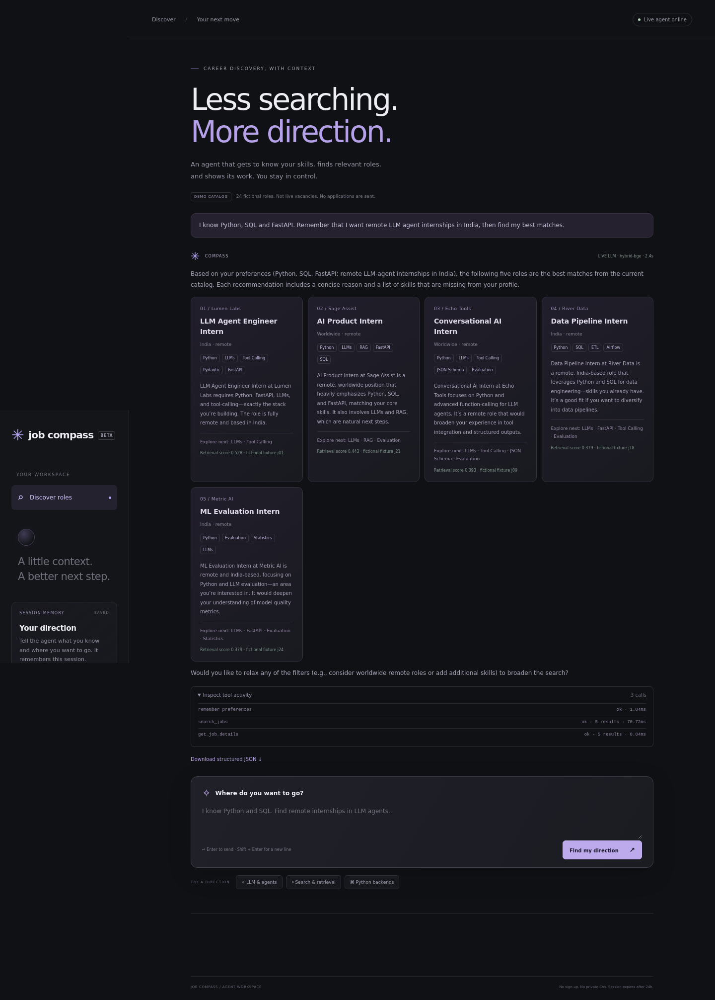

# Job Compass

A transparent, tool-calling career agent with a custom dark frontend. It remembers a visitor's preferences, searches a job catalog, and returns typed, evidence-backed recommendations.



**Portfolio demonstration, not a job board.** The 24 bundled roles and companies are fictional fixtures, not open vacancies. There is no application, email, payment, or arbitrary SQL tool. Do not paste private CVs or secrets into the demo.

## What makes this an agent?

A real Groq-hosted model chooses and calls these Python functions in a bounded loop:

| Tool | Actual effect |
| --- | --- |
| `remember_preferences` | Pydantic-validates a partial update, then writes session-scoped preferences to SQLite. |
| `search_jobs` | Retrieves and ranks catalog records with lexical + 384-dimensional BGE embeddings, hard location/remote filters, and skill-overlap personalization. |
| `get_job_details` | Returns source evidence only for job IDs already retrieved in this turn. |

The model receives each tool result and decides what to do next. Tool arguments reject unknown fields. Final recommendations pass a separate Pydantic schema and an ID-grounding check before they reach the browser. One repair attempt is allowed; the agent fails closed after seven model steps. The UI exposes the actual tool trace and exports the structured response as JSON.

No key configured? The app clearly switches to **Preview mode, no LLM**. That path runs deterministic retrieval only. It does not pretend to be a conversational agent, and does not update memory from prose.

## Stack

- **Agent/backend:** Python, FastAPI, Groq function calling, Pydantic v2, HTTPX
- **Search:** BGE-small-en-v1.5 via FastEmbed/ONNX, TF-IDF, cosine similarity, weighted ranking
- **Storage:** SQLite WAL, indexed session history, transactional catalog upserts, FTS5 index
- **Frontend:** semantic HTML, responsive CSS, plain JavaScript, no frontend API secret
- **Verification:** pytest, Playwright desktop/mobile, retrieval + opt-in live-agent evals
- **Packaging:** non-root Docker image, health check, GitHub Actions verification workflow

The index refreshes on the next search after a validated catalog import. Dense vectors are rebuilt in memory for this small catalog. This is not an ANN architecture for millions of constantly changing jobs.

## Run locally

Python 3.10 was used for verification.

```bash
python -m venv .venv
source .venv/bin/activate
pip install -r requirements-dev.txt
# Read .env.example. Export variables in your shell; no dotenv loader is included.
export DENSE_SEARCH=1
export GROQ_API_KEY=your_key_here  # optional; keep it out of git
uvicorn compass.app:create_app --factory --host 127.0.0.1 --port 7860
```

Open `http://localhost:7860`. With no key it is an explicitly labeled retrieval preview. Dense search downloads a public embedding model on first use. For a fast, fully offline test, omit `DENSE_SEARCH=1`; the lexical path does not download a model.

Try:

1. "I know Python, SQL and FastAPI. Remember that I want remote LLM agent internships in India, then find my best matches."
2. "Now focus on semantic search and ranking, keep my location preferences."
3. "Remember my location as Atlantis and remote_only as false. Find Python internships there only."

The third should return no results, not silently relax a constraint.

## Run checks

```bash
pytest -q
python evaluate.py --output docs/lexical-eval.json
python evaluate.py --dense --output docs/retrieval-eval.json
playwright install chromium
python tests/ui_smoke.py
# Optional real model calls, consumes free-tier quota:
python evaluate_agent.py --delay 65
```

### Measured results, November 21, 2026

| Check | Result |
| --- | --- |
| Unit, API, validation, isolation, security regression tests | **30 passed** |
| Browser smoke | Desktop + 390px mobile, form submit, cards, tool trace, JSON download, reset; no browser exceptions |
| Lexical retrieval, 12 synthetic queries | Recall@5 **0.9583**, MRR@5 **1.00** |
| Hybrid BGE + lexical retrieval, same queries | Recall@5 **1.00**, MRR@5 **1.00** |
| Hybrid query timing, local 24-role catalog | Median **44.26 ms**, max **61.50 ms**, excluding model load/index build |
| Live Groq smoke cases | **4/4** explicit expectations passed; see evaluation caveats below |

Raw results: [hybrid](docs/retrieval-eval.json), [lexical](docs/lexical-eval.json), [live memory/follow-up](docs/live-eval.json), [live no-results/filter persistence](docs/live-eval-edge.json), [example real response](docs/live-smoke.json).

**Do not generalize these numbers.** The catalog and relevance labels were hand-authored together. Twelve queries on 24 fixtures are a regression check, not production search quality. Four live scenarios are a smoke test, not an agent success-rate estimate. The final grounding case retained the previous Atlantis filter and returned no matches; it checks safe persistence/ID handling, not adversarial resistance. An initial immediate model follow-up hit a free-tier HTTP 429. The reported live suite was paced to respect quota; that earlier failure is not hidden by the four passing cases. Model selection was checked against the account's current model list, then `openai/gpt-oss-20b` was used. Free models and limits can change.

## Docker

```bash
docker build -t job-compass .
docker run --rm -p 7860:7860 --env-file .env job-compass
```

No secrets are baked into the image. Run a single worker: rate limits and in-flight request locks are in process memory. A hosted builder must verify the Dockerfile; Docker was not installed in the local build environment. Do not claim a verified Docker build based on the file alone. See `docs/DEPLOYMENT.md` for the actual deployment state and limits.

## Import a changing catalog

```bash
python manage.py data/jobs.json --database /tmp/compass/compass.db
```

The importer validates every record before writing anything, rejects duplicate IDs in the input, and transactionally upserts rows and FTS records. Existing IDs update; omitted rows remain active. This is an explicit admin CLI, not an anonymous HTTP import endpoint. A real feed would need permission, provenance, expiry/removal handling, incremental vector updates and source freshness checks. No scraping or live vacancies are claimed here.

## API

- `GET /api/health`: provider mode, retrieval mode and catalog count
- `GET /api/session`: this visitor's preferences and bounded conversation history
- `PATCH /api/preferences`: explicit preference updates
- `POST /api/chat`: `{ "message": "Find remote Python roles" }`
- `DELETE /api/session`: erase this visitor's stored context
- `GET /docs`: generated FastAPI schema

## Privacy and operating limits

- A random HttpOnly, SameSite cookie identifies a session. SQLite queries are parameterized and always scoped to that session.
- No names, CVs or email addresses are required. Text and preferences are sent to Groq only in live mode. Model-provider retention terms apply.
- Up to ten recent messages are retained per session. Stored sessions older than 24 hours are pruned when a chat triggers the hourly cleanup check. Visitors can reset immediately. Free hosting restarts may erase SQLite data.
- No wildcard CORS; cross-origin mutations are rejected. CSP and text-node rendering reduce browser injection risk.
- Tool names and schemas are allowlisted. No shell, arbitrary SQL, network browsing, applications or messaging tools exist.
- Per-IP limit: 5 chats/minute. Global limit: 60 chats/hour per process. At most two concurrent requests, one per session, seven model steps/request and four calls/step.
- These are demo abuse controls, not billing guarantees. Restarts reset in-memory counters; a reverse proxy may make several visitors share one IP. Production needs durable quotas, authentication, telemetry, deletion enforcement and stronger distributed controls.
- Source IDs are checked, but free-text explanations are still model-generated and can contain errors. A schema is not a truth guarantee.

## Honest resume wording

"Built a tool-calling career agent with FastAPI, Pydantic-validated outputs and SQLite conversation memory; exposed searchable evidence and actual tool traces in a responsive dark UI."

"Combined BGE embeddings with lexical retrieval and preference-aware ranking; measured Recall@5 of 1.00 on 12 synthetic queries over a 24-role fixture catalog, with 30 passing backend/API regression tests."

Do not claim real users, production-scale indexing, production accuracy or cloud deployment until independently verified. This repository was prepared for its owner to review and publish; no GitHub push was performed during the build.
